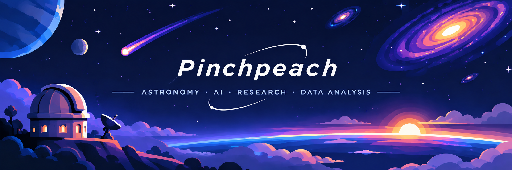

<strong><big><big>Hi, I'm CHOI 👋</big></big></strong>

**Research-Oriented Developer**  
Astronomy · Machine Learning · Scientific Computing

## About Me

I'm a developer interested in exploring scientific problems through **computational methods, machine learning, and data analysis**.

My primary interests lie in astronomical data analysis, scientific software development, and research automation. I enjoy transforming theoretical concepts into practical tools and reproducible computational workflows.

| | |
|---|---|
| **Primary Fields** | Astronomy, Machine Learning, Data Science |
| **Research Interests** | Astronomical Classification, Numerical Methods, Scientific Computing |
| **Development Interests** | Research Automation, AI Systems, Data Visualization |
| **Current Focus** | Multi-Wavelength Astronomy & Academic Research Tools |

## Languages & Technologies

### Programming Languages

### Machine Learning & Scientific Computing

### Development Tools

## Research Interests

- **Astronomy & Astrophysics:** Observational astronomy, compact objects, neutron stars, and multi-wavelength analysis.
- **Machine Learning:** Classification, ensemble methods, neural networks, and predictive modeling.
- **Scientific Computing:** Numerical simulations, Fourier analysis, signal processing, and statistical methods.
- **Research Automation:** Academic literature discovery, citation networks, and research visualization.

## Featured Projects

### 🔭 [Finding_objects](https://github.com/Pinchpeach/Finding_objects)

**Multi-Wavelength Astronomical Object Detection & Classification**

<!-- Optional project image: assets/finding-objects.png -->

A scientific software system for identifying and classifying astronomical objects using observational data from radio to X-ray wavelengths.

- Integrates observations from **28 astronomical archive collectors**.
- Combines literature-based rules with machine learning classifiers.
- Identifies stars, galaxies, quasars, and detailed astrophysical subclasses.
- Provides confidence estimates, supporting evidence, and interactive sky visualization.
- Supports independent validation and reproducible benchmarking.

**Reported Validation:** 99.15% / 99.16% blind classification accuracy across two independent validation field sets (v2.44.0).

**Research Areas:** Astronomy · Machine Learning · Multi-Wavelength Data

[Source Code](https://github.com/Pinchpeach/Finding_objects) · [Documentation](https://github.com/Pinchpeach/Finding_objects/blob/main/README.md) · [Releases](https://github.com/Pinchpeach/Finding_objects/releases)

### 📚 [Research Radar](https://github.com/Pinchpeach/research-radar)

**Academic Literature Discovery & Research Evolution Visualization**

<!-- Optional project image: assets/research-radar.png -->

A cross-platform research application for discovering academic literature, identifying foundational publications, and visualizing the evolution of scientific fields.

- Retrieves publications and citation metadata through **OpenAlex**.
- Ranks papers using relevance, citation relationships, and research influence.
- Visualizes research development through interactive citation-based maps.
- Supports PDF annotation, bookmarking, and reading management.
- Provides desktop and Android applications.

**Research Areas:** Information Retrieval · Citation Analysis · Research Automation

[Source Code](https://github.com/Pinchpeach/research-radar) · [Documentation](https://github.com/Pinchpeach/research-radar/blob/main/README.md) · [Releases](https://github.com/Pinchpeach/research-radar/releases)

## Ongoing Projects

| Project | Description | Focus |
|---|---|---|
| [**ML_pr**](https://github.com/Pinchpeach/ML_pr) | Machine learning experiments and ensemble classification pipelines. | Deep Learning |
| [**Supportive-App-for-Mil**](https://github.com/Pinchpeach/Supportive-App-for-Mil) | Regional risk prediction using weather and accident datasets. | Predictive Modeling |
| **Multi-Agent Collaboration Hub** | Shared workspaces and coordination for independent AI agents. | Multi-Agent Systems |
| [**apps_pr**](https://github.com/Pinchpeach/apps_pr) | Experimental applications and API-based data visualization. | Software Development |

## Current Focus

- Astronomical object classification and multi-wavelength data integration.
- Scientific computing and machine learning applications.
- Academic literature discovery and research automation.
- Autonomous and collaborative AI systems.

---

<em>Exploring the intersection of science, computation, and intelligent systems.</em>

